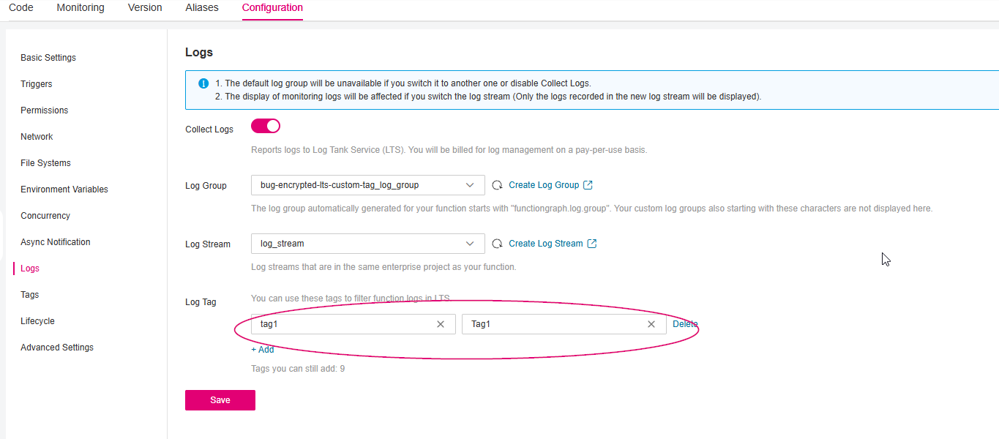

# bug-fg-lts-tag-tf

Sample code for https://github.com/opentelekomcloud/terraform-provider-opentelekomcloud/issues/3654

Changing **lts_custom_tag** in **opentelekomcloud_fgs_function_v2** has no effect.

Following environment variables must be set:

| Environment variable | description                                     |
| -------------------- | ----------------------------------------------- |
| OTC_SDK_AK           | Access key                                      |
| OTC_SDK_SK           | Secret key                                      |
| OTC_SDK_DOMAIN_NAME  | Domain name eg. OTC-EU-DE-000000000010000XXXXX" | 
| OTC_SDK_PROJECTNAME  | Project name e.g. eu_de                         |
| OTC_IAM_ENDPOINT     | https://iam.eu-de.otc.t-systems.com/v3          |

## Terraform provider version

- 1.37.14

## Affected Ressource

- opentelekomcloud_fgs_function_v2
  
  Argument:

  ```
  lts_custom_tag = jsonencode({
    "Tag1" : "Hello"
    #"tag2" = "Tag2"    
  })
  ```

## Terraform Configuration Files

see folder [terraform](./terraform)

## Steps to Reproduce

1. Set environment variables according to README.md
2. change folder to terraform `cd terraform`
3. execute `terraform init`
4. execute `terraform apply -auto-approve`
```
Terraform used the selected providers to generate the following execution plan. Resource actions are indicated with the following symbols:
  + create

Terraform will perform the following actions:

  # opentelekomcloud_fgs_function_v2.myfunction will be created
  + resource "opentelekomcloud_fgs_function_v2" "myfunction" {
      + allow_ephemeral_storage = (known after apply)
      + apig_route_enable       = (known after apply)
      + app                     = "default"
      + app_agency              = (known after apply)
      + code_filename           = "index.py"
      + code_type               = "inline"
      + concurrency_num         = (known after apply)
      + depend_list             = (known after apply)
      + description             = "Test function"
      + dns_list                = (known after apply)
      + enable_auth_in_header   = (known after apply)
      + enable_lts_log          = true
      + enterprise_project_id   = (known after apply)
      + ephemeral_storage       = (known after apply)
      + extend_config           = (known after apply)
      + func_code               = "4ebdc769dab2b4f497d889175045101a16be74f5"
      + functiongraph_version   = (known after apply)
      + gpu_type                = (known after apply)
      + handler                 = "index.handler"
      + heartbeat_handler       = (known after apply)
      + id                      = (known after apply)
      + is_stateful_function    = (known after apply)
      + log_group_id            = (known after apply)
      + log_group_name          = "bug-encrypted-lts-custom-tag_log_group"
      + log_topic_id            = (known after apply)
      + log_topic_name          = "log_stream"
      + lts_custom_tag          = {
          + "tag1" = "Tag1"
        }
      + max_instance_num        = "1"
      + memory_size             = 128
      + mount_user_group_id     = (known after apply)
      + mount_user_id           = (known after apply)
      + name                    = "bug-encrypted-lts-custom-tag"
      + region                  = (known after apply)
      + runtime                 = "Python3.10"
      + tags                    = {
          + "app_group" = "bug-encrypted-lts-custom-tag"
        }
      + timeout                 = 3
      + urn                     = (known after apply)
      + version                 = (known after apply)

      + custom_image (known after apply)

      + func_mounts (known after apply)

      + versions (known after apply)
    }

  # opentelekomcloud_lts_group_v2.LogGroup will be created
  + resource "opentelekomcloud_lts_group_v2" "LogGroup" {
      + created_at            = (known after apply)
      + enterprise_project_id = (known after apply)
      + group_name            = "bug-encrypted-lts-custom-tag_log_group"
      + id                    = (known after apply)
      + region                = (known after apply)
      + tags                  = {
          + "app_group" = "bug-encrypted-lts-custom-tag"
        }
      + ttl_in_days           = 1
    }

  # opentelekomcloud_lts_stream_v2.log_stream will be created
  + resource "opentelekomcloud_lts_stream_v2" "log_stream" {
      + created_at            = (known after apply)
      + enterprise_project_id = (known after apply)
      + filter_count          = (known after apply)
      + group_id              = (known after apply)
      + id                    = (known after apply)
      + region                = (known after apply)
      + stream_name           = "log_stream"
      + tags                  = {
          + "app_group" = "bug-encrypted-lts-custom-tag"
        }
      + ttl_in_days           = (known after apply)
    }

Plan: 3 to add, 0 to change, 0 to destroy.
opentelekomcloud_lts_group_v2.LogGroup: Creating...
opentelekomcloud_lts_group_v2.LogGroup: Creation complete after 1s [id=cb538020-95d6-475c-b271-5305af7feb73]
opentelekomcloud_lts_stream_v2.log_stream: Creating...
opentelekomcloud_lts_stream_v2.log_stream: Creation complete after 1s [id=7631e49d-5719-44d3-9dfc-83db19710134]
opentelekomcloud_fgs_function_v2.myfunction: Creating...
opentelekomcloud_fgs_function_v2.myfunction: Creation complete after 1s [id=urn:fss:eu-de:d52e41d2434941b194ce3f91b1b12f8a:function:default:bug-encrypted-lts-custom-tag:latest]

Apply complete! Resources: 3 added, 0 changed, 0 destroyed.
```

5. Uncomment  ```#"tag2" = "Tag2"``` in **main.tf** and execute apply again: `terraform apply -auto-approve`

```
opentelekomcloud_lts_group_v2.LogGroup: Refreshing state... [id=cb538020-95d6-475c-b271-5305af7feb73]
opentelekomcloud_lts_stream_v2.log_stream: Refreshing state... [id=7631e49d-5719-44d3-9dfc-83db19710134]
opentelekomcloud_fgs_function_v2.myfunction: Refreshing state... [id=urn:fss:eu-de:d52e41d2434941b194ce3f91b1b12f8a:function:default:bug-encrypted-lts-custom-tag:latest]

Terraform used the selected providers to generate the following execution plan. Resource actions are indicated with the following symbols:
  ~ update in-place

Terraform will perform the following actions:

  # opentelekomcloud_fgs_function_v2.myfunction will be updated in-place
  ~ resource "opentelekomcloud_fgs_function_v2" "myfunction" {
        id                      = "urn:fss:eu-de:d52e41d2434941b194ce3f91b1b12f8a:function:default:bug-encrypted-lts-custom-tag:latest"
      ~ lts_custom_tag          = {
          + "tag2" = "Tag2"
            # (1 unchanged element hidden)
        }
        name                    = "bug-encrypted-lts-custom-tag"
        tags                    = {
            "app_group" = "bug-encrypted-lts-custom-tag"
        }
        # (45 unchanged attributes hidden)

        # (1 unchanged block hidden)
    }

Plan: 0 to add, 1 to change, 0 to destroy.
opentelekomcloud_fgs_function_v2.myfunction: Modifying... [id=urn:fss:eu-de:d52e41d2434941b194ce3f91b1b12f8a:function:default:bug-encrypted-lts-custom-tag:latest]
opentelekomcloud_fgs_function_v2.myfunction: Modifications complete after 1s [id=urn:fss:eu-de:d52e41d2434941b194ce3f91b1b12f8a:function:default:bug-encrypted-lts-custom-tag:latest]

Apply complete! Resources: 0 added, 1 changed, 0 destroyed.
```

Output tells that ressource has been changed but FunctionGraph console shows:




## Actual Behaviour

Configuration -> Logs -> Log Tag not changed

## Expected Behaviour

Configuration -> Logs -> Log Tag changed
